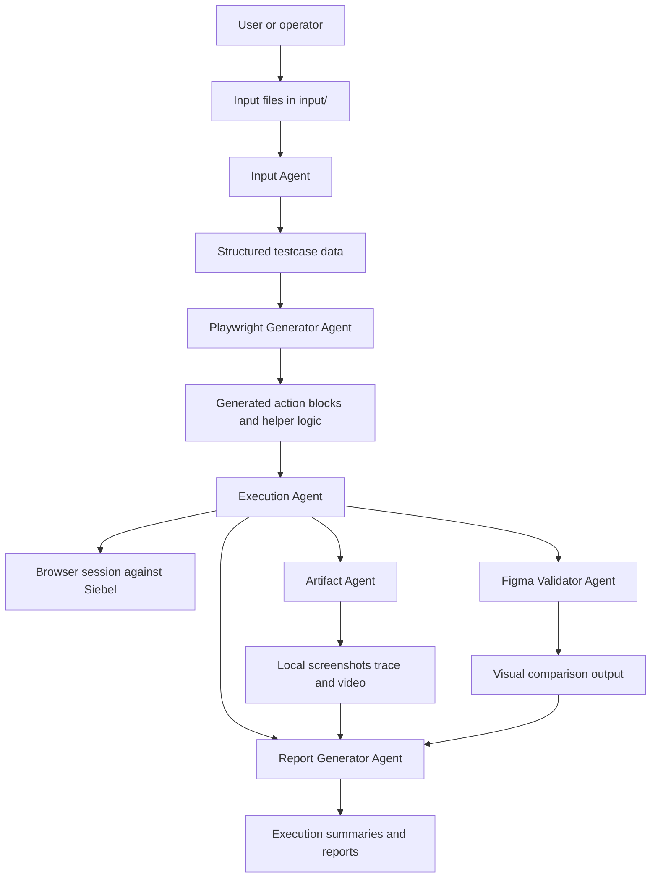

# Agent Architecture

## End-to-end flow

## Component responsibilities

### Input Agent
- reads raw CSV or Excel
- normalizes testcase structure
- exposes `Order_Steps` and `Post_Verification`

### Playwright Generator Agent
- converts business steps into Playwright actions
- adds robust locators and fallback waits
- derives reusable journey runtime options

### Execution Agent
- runs generated or reference automation
- applies pass/fail logic against visible UI state
- coordinates artifacts and reporting

### Artifact Agent
- captures screenshots
- collects traces and video
- stores runtime evidence locally

### Figma Validator Agent
- compares expected and actual visuals when needed

### Report Generator Agent
- produces structured output for execution results
- summarizes journey status and supporting evidence

## Design rule
Shared behavior belongs in skills.

Journey-specific differences should be minimized and isolated outside the shared core when possible.