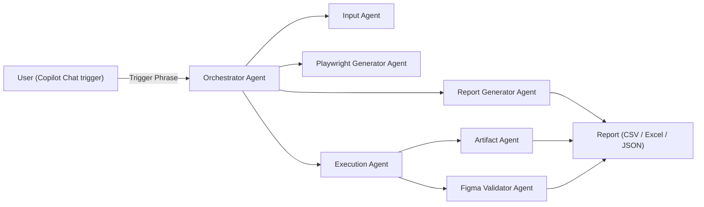

# Dependency Diagram

The following diagram shows agent execution flow and dependencies.

- Flow: User -> Orchestrator -> Child Agents -> Report
- Artifact contract: all agent-to-agent communication happens via `output/agents/*.json` artifacts and `output/artifacts/<TOM>/` folders.
